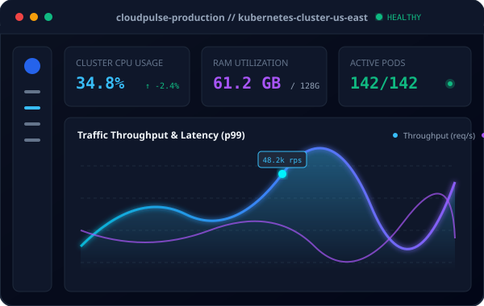

# 🚀 Jaydip - Personal Developer Portfolio

A modern, premium, and visually stunning personal portfolio website engineered for **Jaydip**, Software Developer. Built with modern web standards, glassmorphism effects, electric neon accents, interactive 3D physics, and a responsive mobile-first architecture.



---

## 🌟 Key Features & Highlights

- **Aesthetic Dark Theme**: Deep black and navy slate backgrounds (`#07090e`, `#0f172a`) paired with electric blue, cyber cyan, and neon violet glowing accents.
- **Dynamic Theme Switcher**: 4 built-in theme presets (**Cyber Cyan**, **Neon Violet**, **Matrix Emerald**, **Hyper Sapphire**) with persistent preferences saved to `localStorage`.
- **Glassmorphism UI**: Multi-layered backdrop blurs (`backdrop-filter: blur(20px)`), frosted translucent borders, and subtle glowing rim lighting.
- **Interactive Background**: Live HTML5 Canvas constellation mesh with mouse attraction physics and a floating ambient spotlight.
- **Hero Code Terminal Visual**: An interactive IDE card with syntax highlighting, live typing cursor effect, and a 1-click snippet copy button.
- **Modular Data Architecture (`js/data.js`)**: All personal information, skills, projects, work experience, education, and achievements are organized in a clean configuration file. **Update your portfolio in under 2 minutes without touching complex markup!**
- **Skills & Technologies**:
  - Filterable by: **Programming Languages**, **Frontend Development**, **Backend Development**, **Databases**, and **Tools & Technologies**.
  - Animated proficiency indicators and custom tech icons.
- **Projects Showcase**:
  - Filter by category (**All**, **Full Stack**, **Frontend**, **Backend/AI**).
  - Real-time search filter by project name, tech stack, or keywords.
  - Interactive **3D tilt card physics** responding to cursor movement.
  - **Quick Details Modal** for architecture deep-dives and performance metrics.
  - Direct **Live Demo** and **GitHub Source Code** links.
- **Experience & Education**:
  - Sleek vertical glowing neon timeline.
  - Interactive tabs to switch between **Work Experience** and **Education**.
- **Interactive Contact Section**:
  - Client-side validated form with interactive loading and success states.
  - Direct 1-click **Copy Email** button with instant floating toast notification.
  - Direct social links (GitHub, LinkedIn, Instagram, Email).
- **Subtle Audio Feedback**: Synthesized futuristic audio cues using the native **Web Audio API** (toggleable via the top audio button).
- **Mobile First & Responsive**: Optimized navigation drawer, smooth scrolling, and responsive breakpoints down to small phone screens.

---

## 📁 Project Structure

```
portfolio/
├── index.html              # Main HTML5 entry document
├── package.json            # Scripts & project metadata
├── README.md               # Documentation & setup guide
├── css/
│   └── style.css           # Glassmorphism, animations, responsive design
├── js/
│   ├── data.js             # ⚙️ CONFIG FILE: Edit your bio, skills, projects, etc.
│   └── main.js             # Canvas, 3D tilt, audio synthesizer, filters, modals
└── assets/
    ├── icons/
    │   └── favicon.svg     # Stylized geometric logo
    └── images/
        ├── avatar.svg      # Developer workstation illustration
        ├── project-1.svg   # CloudPulse DevOps Dashboard
        ├── project-2.svg   # DevSync Collaborative IDE
        ├── project-3.svg   # Nexus AI Multi-Agent Platform
        ├── project-4.svg   # CryptoOrbit Trading Terminal
        ├── project-5.svg   # ShopStream Headless E-Commerce
        └── project-6.svg   # TaskForge Agile Workspace
```

---

## 🛠️ How to Customize Your Information

You can customize almost everything on the site simply by editing **`js/data.js`**:

1. **Personal Information & Bio**:
   - Change your name, headline, short bio, full about me paragraphs, email, and social media URLs (GitHub, LinkedIn, Instagram).
2. **Skills & Categories**:
   - Add, edit, or reorder your skills under `skills` in `js/data.js`. Each skill takes a name, category, icon, level percentage, and highlight description.
3. **Projects Showcase**:
   - Add new projects with thumbnails, titles, short and full descriptions, tech tags, and links to your live websites and GitHub repos.
4. **Experience & Education**:
   - Update companies, roles, dates, locations, key bullet points, and tech stacks.

---

## 💻 How to Run Locally

### Option 1: Double-click to open
Simply double-click `index.html` in your file explorer to open it directly in any modern browser (Chrome, Edge, Firefox, Safari).

### Option 2: Run with local server (Recommended)
```bash
# Using npx (no install required if Node is installed)
npx serve .

# Or using Python
python -m http.server 3000
```
Then visit `http://localhost:3000` in your browser.

---

## 🌐 Free Instant Deployment

### GitHub Pages:
1. Push this repository to GitHub.
2. In your repo, go to **Settings > Pages**.
3. Under **Branch**, select `main` (root) and click **Save**.
4. Your portfolio will be live at `https://<username>.github.io/<repo-name>/`.

### Vercel / Netlify:
- Drag and drop the folder into the [Netlify Drop](https://app.netlify.com/drop) dashboard or import the repository in [Vercel](https://vercel.com/) with zero configuration needed.

---

## 📜 License
MIT License. Feel free to use this template for your own developer portfolio!
